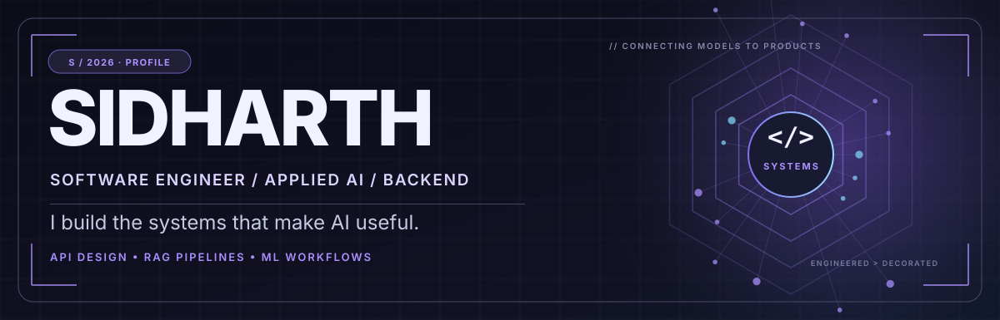
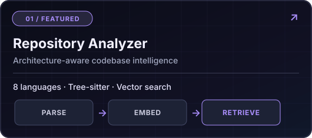
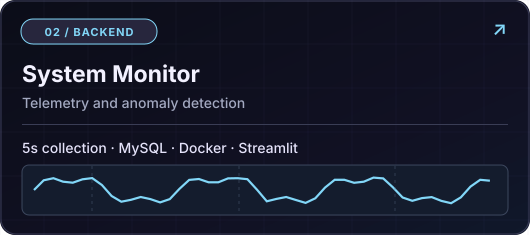
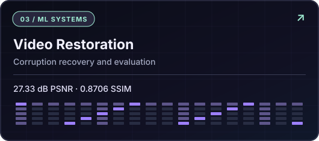
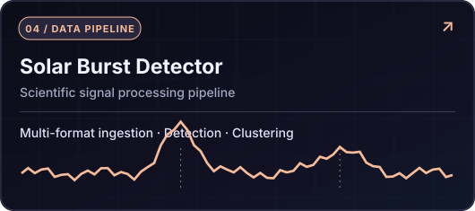
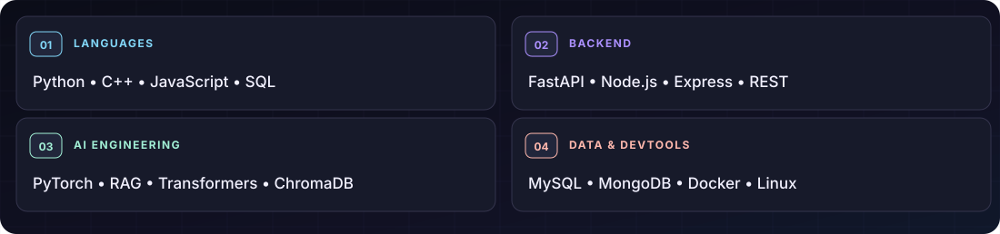
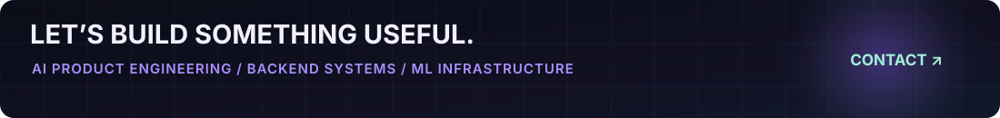

  <picture>
    <source media="(max-width: 600px)" srcset="./assets/hero-mobile.svg" />
    
  </picture>

   

  
  
  
  

    

  **Software Engineering · Applied AI · Backend Development**

  Building practical AI applications, reliable APIs, and the infrastructure connecting data, models, and users.

---

### `01 / About me`

I’m **Sidharth**, an Electrical Engineering undergraduate at **IIT Jammu (2028)**, focused on **software engineering roles in AI/ML and backend development**. I like solving problems across the whole stack: how data enters a system, how a model or retrieval pipeline processes it, and how an API delivers the result reliably.

- **Currently exploring:** scalable backends, code intelligence, RAG systems, and ML infrastructure.
- **My engineering approach:** clean interfaces, measurable performance, sensible fallbacks, and useful products.
- **Outside building:** competitive programming — **1,100+ problems** solved across platforms, with a **1522 Codeforces peak rating**.

### `02 / Selected engineering work`

<table>
  <tr>
    <td width="50%" valign="top">
      
       <b>AI-Powered GitHub Repository Analyzer</b> 
      An architecture-aware RAG application: Tree-sitter parsing, embeddings, ChromaDB retrieval, FastAPI endpoints, and LLM fallback. 
      <b>Python · FastAPI · Tree-sitter · ChromaDB · RAG</b> 
      <a href="https://github.com/sidharthWadhwa726/AI-Powered-GitHub-Repository-Analyzer">Source code ↗</a>
    </td>
    <td width="50%" valign="top">
      
       <b>Real-Time System Monitor</b> 
      Collects CPU, memory, disk, GPU, and network metrics at 5-second intervals; stores data in MySQL and visualizes it with Streamlit. 
      <b>Python · MySQL · Docker · Streamlit · Linux</b> 
      <a href="https://github.com/sidharthWadhwa726/Real_Time_System_Monitor">Source code ↗</a>
    </td>
  </tr>
  <tr>
    <td width="50%" valign="top">
      
       <b>Bitstream-Corrupted Video Restoration</b> 
      PyTorch model adaptation, restoration pipeline tooling, and automated PSNR/SSIM evaluation. Part of a team that placed **4th globally at NTIRE 2026**. 
      <b>Python · PyTorch · Computer Vision · TTA</b> 
      <a href="https://github.com/sidharthWadhwa726/B2SCVR">Project fork ↗</a> · <a href="https://arxiv.org/html/2604.06945v3">Challenge paper ↗</a>
    </td>
    <td width="50%" valign="top">
      
       <b>Solar Burst Detection</b> 
      A multi-format scientific-data pipeline for processing X-ray light curves, extracting burst features, and supporting anomaly detection. 
      <b>Python · Signal Processing · Clustering · PyTorch</b> 
      <a href="https://github.com/sidharthWadhwa726/Identification-Of-Solar-Bursts-IN-X-Ray-Light-Curves">Project fork ↗</a>
    </td>
  </tr>
</table>

**Additional build — PrepForge:** An AI-powered interview-preparation platform built with **React, Node.js, MongoDB, JWT, Gemini, and Puppeteer**. It turns résumé data into tailored study plans and PDF exports. *Source repository is not currently public.*

### `03 / The tools I use`

<picture>
  <source media="(max-width: 600px)" srcset="./assets/tech-stack-mobile.svg" />
  
</picture>

<b>More about my engineering interests</b>

 

- **Backend:** API design, authentication, input validation, asynchronous processing, database-backed services.
- **AI applications:** repository understanding, RAG retrieval, embeddings, LLM integrations, and fallback strategies.
- **ML systems:** model inference workflows, data processing, experiment evaluation, and system telemetry.
- **Foundations:** data structures, algorithms, operating systems, databases, and Linux.

### `04 / Highlights beyond the code`

| Engineering and problem solving | Highlights |
|:--|:--|
| **NTIRE 2026** | **4th globally** in Bitstream-Corrupted Video Restoration (team result) |
| **Competitive programming** | Codeforces **Specialist** · peak rating **1522** |
| **Algorithms** | **1,100+** problems solved across LeetCode and Codeforces |
| **Mentoring** | Mentored **50+ students** in competitive programming and ML topics |

### `05 / GitHub activity`

> I care more about shipping useful code than optimizing contribution charts. Browse the repositories above or [explore my public activity](https://github.com/sidharthWadhwa726?tab=overview).

<h2 align="center">GitHub Contribution Activity</h2>

  

### `06 / Contact`

  <a href="mailto:wadhwasidharth84@gmail.com">Email</a> ·
  <a href="https://www.linkedin.com/in/sidharth-664662319/">LinkedIn</a> ·
  <a href="https://github.com/sidharthWadhwa726">GitHub</a> ·
  <a href="https://codeforces.com/profile/sidharth_wadhwa">Codeforces</a>

Designed for engineering work, not for collecting badges. · Obsidian AI Studio

